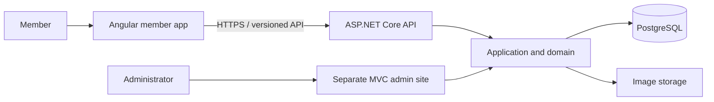

# 

  

  
  

## ✨ The work in progress

**Afterglow** is a full-stack community platform, built across two repositories: a .NET backend and an Angular member-facing application. The project brings together member profiles, discovery, photo albums, diaries, invitations, and private messaging.

> 🚧 Afterglow is an early-stage development project. The backend is for development and synthetic data only—not production or real member data.

## 🧩 Explore the project

<table>
  <tr>
    <td width="50%" valign="top">
      <h3><a href="https://github.com/zvartzaft/afterglow-backend">⚙️ Afterglow Backend</a></h3>
      
Versioned API, separate administrator site, application and domain layers, PostgreSQL persistence, and automated tests.

      

        
        
        
        
      

    </td>
    <td width="50%" valign="top">
      <h3><a href="https://github.com/zvartzaft/afterglow-frontend">🎨 Afterglow Frontend</a></h3>
      
Angular member experience with English and Swedish localization, profiles, diaries, photos, and conversations.

      

        
        
        
        
      

    </td>
  </tr>
</table>

  
  

## 🏗️ One platform, two applications

## 🛠️ The toolkit

  
  
  
  
  
  

  
🔍 Peek at the project principles

   
  <ul>
    <li><strong>Clear boundaries:</strong> separate member and administrator experiences, with layered backend responsibilities.</li>
    <li><strong>Careful account flows:</strong> antiforgery protection, rate limits, email verification, and explicit recovery flows.</li>
    <li><strong>Useful tests:</strong> unit, integration, and architecture tests on the backend, plus frontend unit tests.</li>
    <li><strong>Accessible to more members:</strong> English and Swedish UI with localized page and form feedback.</li>
  </ul>

## 📊 GitHub at a glance

  
  

  

  

  Made with curiosity, code, and a little afterglow. ✨

